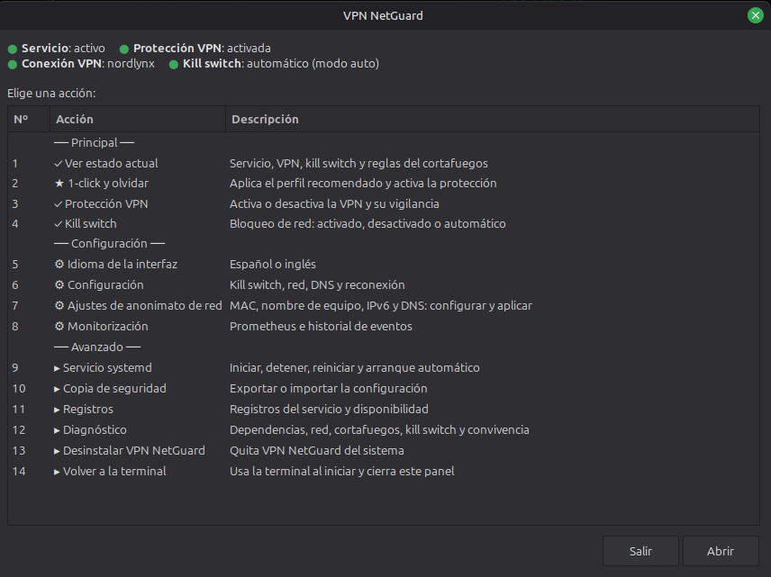
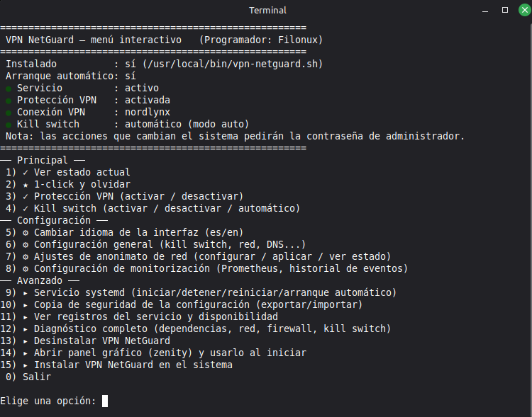
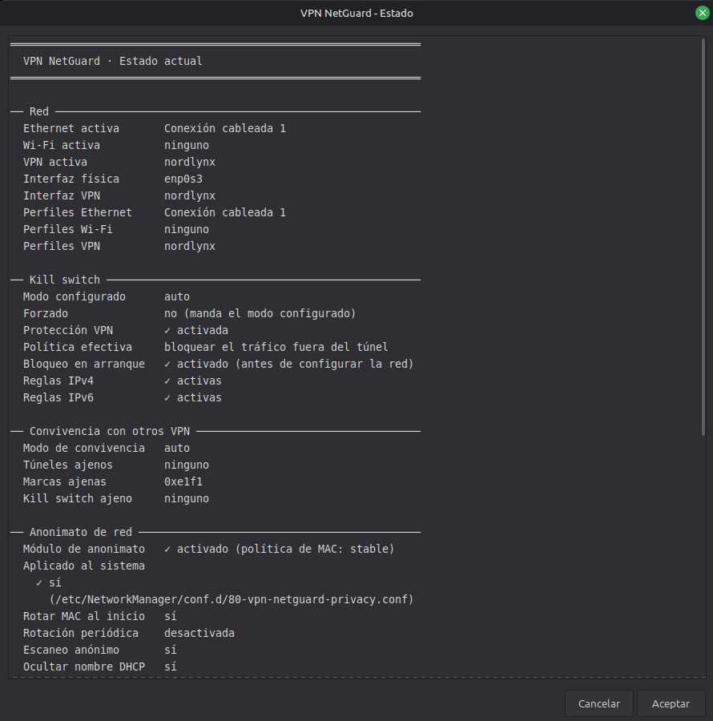
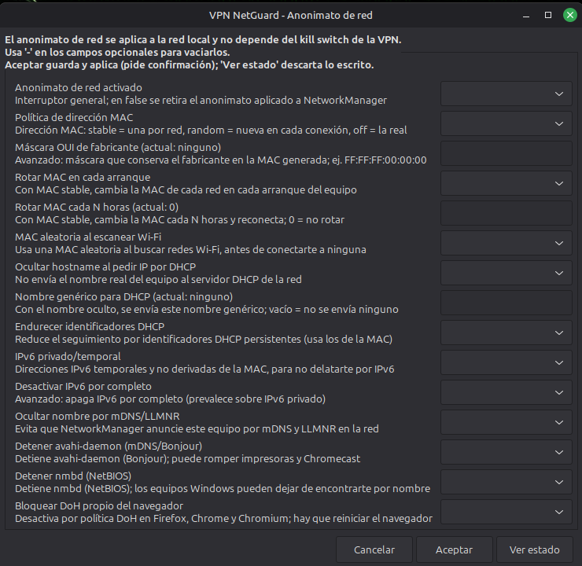
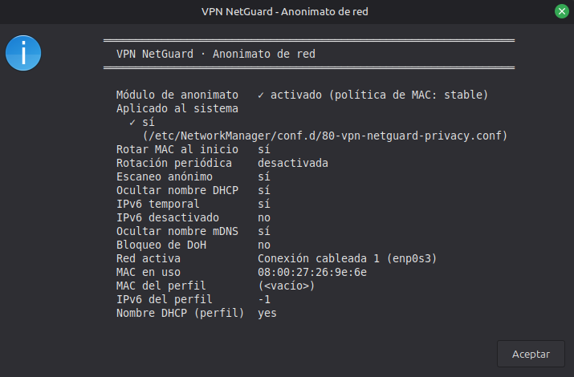

<p align="center">
  
</p>

<h1 align="center">VPN NetGuard</h1>

<p align="center">
  Kill switch, reconexión automática y anonimato de red para tu VPN en Linux.<br>
  Un único script: panel gráfico, menú de terminal o servicio systemd headless — tú eliges.
</p>

<p align="center">
  
  
  
  <a href="LICENSE.txt"></a>
  
</p>

<p align="center">
  <b>Español</b> · <a href="README.md">English</a>
</p>

---

## Novedades de la 2.6.0

Todo lo que cambia respecto a la 1.0.0:

- **Kill switch y protección VPN, por separado.** «Protección VPN» (entrada 3: activar o desactivar) y «Kill switch» (entrada 4: activar, desactivar o automático) son ahora dos entradas distintas. Antes, tras quitar el kill switch no había forma directa de volver a automático; ahora la hay: `killswitch auto`. [Uso diario](#uso-diario)
- **El mismo menú en la terminal y en el panel.** Numerado, con los mismos números en los dos, en tres grupos (Principal, Configuración y Avanzado) y el estado arriba del todo. Tú eliges con qué interfaz arrancan `vpn-netguard.sh` y el lanzador del menú de Aplicaciones. [El menú](#el-menú) · [Interfaz de arranque](#interfaz-de-arranque)
- **Convive con el kill switch de otros clientes VPN** (NordVPN, ProtonVPN...). Dos kill switch a la vez se cortan la red el uno al otro. Ahora VPN NetGuard deja pasar los túneles de otros clientes y cede el bloqueo mientras otro kill switch esté activo (`COEXIST_MODE`), y `VPN_IGNORE` evita que reconecte o desconecte los perfiles de NetworkManager de otros proveedores. [Convivencia con otros clientes VPN](#convivencia-con-otros-clientes-vpn)
- **Reglas de cortafuegos que no estorban.** Las excepciones acaban en `RETURN`, no en `ACCEPT`, así que ya no se saltan las reglas posteriores de `ufw`, Docker u otros kill switch, y el salto a la cadena ya no se borra y se reinserta en cada comprobación: no hay ventana sin bloqueo ni disputa por la primera posición.
- **«1-click y olvidar».** Perfil equilibrado y compatible con una sola contraseña (antes pedía hasta cuatro), copia de seguridad de la configuración y resumen final. No toca lo que puede romper cosas: impresoras, Chromecast y carpetas compartidas. [1-click y olvidar](#1-click-y-olvidar)
- **Estado y ajustes más claros.** «Ver estado actual» reúne red, kill switch, convivencia y anonimato de red en una sola pantalla; cada ajuste lleva una explicación de una línea; un guardado rechazado dice por qué; y en el panel la carpeta de métricas se elige con un selector de carpetas.
- **El servicio recarga la configuración solo** cuando cambia el fichero, en `CHECK_INTERVAL` segundos como máximo (25 por defecto): sin reiniciar. [Configuración](#configuración)
- **Correcciones.** Los nombres de perfil de NetworkManager con tildes (como «Conexión cableada 1») salían con un `?` y no se podían consultar, reconectar ni excluir; un valor de solo espacios en la configuración (como `DNS_SERVERS=" "`) dejaba vacías sus reglas sin avisar; y `doctor` daba «crítico» sin ningún mensaje cuando solo faltaba `ip6tables`, que es opcional.
- **Más pruebas.** 242 tests (antes 146), 450 pruebas de mutación, ShellCheck y un laboratorio con `iptables` real en un espacio de nombres de red aislado.

## Un vistazo rápido

<p align="center">
  
  
</p>

<p align="center">
  <sub><b>Panel gráfico</b> (izquierda) y <b>menú de terminal</b> (derecha): mismos números, mismo estado arriba del todo.</sub>
</p>

<p align="center">
  
  
</p>

<p align="center">
  <sub><b>Estado actual</b> (izquierda, entrada 1): red, kill switch, convivencia y anonimato de red en una sola pantalla.<br>
  <b>Ajustes de anonimato de red</b> (derecha, entrada 7): cada opción lleva una explicación de una línea.</sub>
</p>

<p align="center">
  
</p>

<p align="center">
  <sub><b>Estado del anonimato de red</b> (entrada 7, «Ver estado»).</sub>
</p>

---

## Índice

- [¿Qué es VPN NetGuard?](#qué-es-vpn-netguard)
- [Primeros pasos](#primeros-pasos)
- [El problema que resuelve](#el-problema-que-resuelve)
- [Qué hace exactamente](#qué-hace-exactamente)
- [Instalación](#instalación)
- [El menú](#el-menú)
- [Comandos](#comandos)
- [Uso diario](#uso-diario)
- [1-click y olvidar](#1-click-y-olvidar)
- [Configuración](#configuración)
- [Convivencia con otros clientes VPN](#convivencia-con-otros-clientes-vpn)
- [Compatibilidad](#compatibilidad)
- [Scriptya](#scriptya)
- [Sobre el idioma](#sobre-el-idioma)
- [Contribuir](#contribuir)
- [Seguridad](#seguridad)
- [Licencia](#licencia)

## ¿Qué es VPN NetGuard?

VPN NetGuard es una **herramienta de privacidad** para Linux. Si usas una VPN para que tu operador de Internet, la red wifi en la que estés o las páginas que visitas no puedan ver lo que haces ni tu ubicación real, VPN NetGuard se encarga de que esa protección no falle sin que te enteres.

En concreto, te protege de dos cosas:

- **De que tu VPN falle en silencio.** Si la conexión se cae, el ordenador se reinicia o el túnel deja de funcionar sin avisar, lo normal es que tu tráfico "real" (sin proteger) empiece a salir a Internet sin que lo notes, dejando al descubierto tu IP y tu actividad. VPN NetGuard corta todo el tráfico en cuanto detecta que la VPN no está funcionando y no deja pasar nada hasta que vuelve a estar activa — ni siquiera durante el propio arranque del equipo.
- **De que te identifiquen aunque la VPN funcione bien.** Al margen de tu tráfico, tu ordenador se presenta ante cualquier red wifi (la del bar, el aeropuerto o la oficina) con datos como su dirección MAC o su nombre de equipo. Eso permite que te reconozcan y te sigan la pista de una red a otra, incluso con la VPN activa. VPN NetGuard puede ocultar y cambiar esos datos automáticamente.

Y esto no depende de que el fallo sea de la propia VPN: si lo que falla es tu conexión a Internet —un wifi inestable que entra y sale, un router que se atasca—, VPN NetGuard responde igual de bien. En cuanto vuelve a haber señal, reconecta la VPN enseguida y por su cuenta, para que estés protegido y de vuelta online cuanto antes, sin que tengas que tocar nada.

En resumen: si tu VPN es la cerradura, VPN NetGuard es quien vigila que la puerta esté siempre bien cerrada — y de paso te ayuda a no dejar huellas por el camino.

Y no hace falta que sea tu ordenador de escritorio: funciona igual en un servidor sin pantalla al que solo entras por SSH —un VPS, un NAS, una Raspberry Pi...—. Es el mismo script en los dos casos: él mismo detecta dónde se está ejecutando y se adapta solo, sin que tengas que indicar nada.

## Primeros pasos

Si solo quieres probarlo, esto es todo lo que hace falta:

1. **Descarga el script:**

   ```bash
   git clone https://github.com/filonux/VPN-NetGuard.git
   cd VPN-NetGuard/script
   ```

2. **Instálalo.** En un escritorio (por ejemplo, Linux Mint):

   ```bash
   pkexec bash vpn-netguard.sh install
   ```

   En un servidor sin pantalla, por SSH:

   ```bash
   sudo bash vpn-netguard.sh install
   ```

   Aparece un asistente (gráfico o de texto, según el caso) que hace un par de preguntas sencillas de sí/no, y con eso ya está instalado.

3. **Úsalo en el día a día** sin volver a tocar la terminal: busca "VPN NetGuard" en el menú de Aplicaciones (o haz doble clic en el icono del Escritorio, si marcaste esa opción al instalar). Se abre una ventana con una lista numerada de acciones agrupadas por categoría; las que usarás casi siempre están arriba del todo —"Ver estado actual", "Protección VPN" (activar o desactivar) y "Kill switch"— y si es la primera vez, "1-click y olvidar" lo deja todo configurado y conectado en un único paso, con una sola contraseña. Haces doble clic en la opción que quieras y, en cuanto termina, la misma ventana vuelve a aparecer para la siguiente, sin comandos que memorizar. [El menú](#el-menú) las lista todas.

   Si prefieres manejarlo desde una terminal (por ejemplo, por SSH en un servidor sin pantalla), existe el mismo menú en modo texto, con la misma numeración: ejecuta `vpn-netguard.sh` sin nada más y elige cada opción con el teclado, sin necesidad de recordar ningún comando tampoco. La terminal es la interfaz de arranque por defecto; si eliges «Abrir panel gráfico (zenity) y usarlo al iniciar», `vpn-netguard.sh` sin argumentos abrirá el panel desde entonces ([Interfaz de arranque](#interfaz-de-arranque)).

¿Necesitas más detalle — banderas para instalación desatendida, cómo desinstalar, la lista completa de comandos...? Sigue leyendo: las secciones de abajo entran en todo lo demás, empezando por el porqué de cada decisión de diseño.

## El problema que resuelve

La mayoría de los "kill switch para VPN" que circulan por foros son dos o tres reglas de `iptables` aplicadas a mano, una vez. Funcionan mientras nada cambia — pero si la VPN se cae de madrugada, el portátil se reinicia o el túnel se queda "zombie" (la interfaz sigue arriba pero el servidor remoto ya no responde), esas reglas no se enteran de nada y tu tráfico real sale a Internet sin protección, sin que lo notes.

VPN NetGuard es un demonio que vigila la conexión sin parar, no una regla suelta. La diferencia se nota justo en los momentos donde un kill switch casero falla: el propio arranque del sistema (antes incluso de que exista red), un túnel zombie que un simple ping no detectaría, o el rato en que nadie está mirando. Por separado, añade un módulo de anonimato de red para que, aunque la VPN vaya perfecta, el router del bar, del aeropuerto o de la oficina no pueda reconocerte por tu MAC, tu IPv6 o el nombre de tu equipo — algo que ningún kill switch por sí solo cubre. El cómo de cada cosa está en el siguiente apartado.

## Qué hace exactamente

VPN NetGuard reúne en un solo fichero lo que antes eran siete (el vigilante, el panel, el instalador, la configuración, dos unidades de systemd y el lanzador de escritorio). Esto es lo que hace:

### Kill switch de verdad (fail-closed)

- Bloquea todo el tráfico saliente que no pase por el túnel VPN, con reglas de `iptables` e `ip6tables` que se aplican de forma atómica: nunca hay un instante en el que la cadena quede a medio construir o vacía.
- Un segundo servicio systemd, independiente del principal, cierra el tráfico *antes* de que la red esté siquiera configurada al arrancar — la ventana de fuga que casi ningún otro script cubre.
- Permite explícitamente lo mínimo necesario para funcionar: DNS (solo hacia los servidores que definas, no hacia cualquiera), el propio establecimiento del túnel, tráfico de tu LAN si lo activas, y ping hacia los objetivos que uses para comprobar que hay Internet real.
- Tres modos, según lo que necesites: `auto` (el bloqueo se activa solo cuando tú activas la VPN), `true` (bloqueo permanente mientras el servicio corre) o `false` (solo vigila y reconecta, sin bloquear nada). Por encima de esos modos, `killswitch on` y `killswitch off` fuerzan el bloqueo o lo quitan, y `killswitch auto` vuelve al modo configurado.
- Convive con el kill switch de otros clientes VPN (NordVPN, ProtonVPN...): por defecto deja pasar sus túneles y cede el bloqueo mientras el suyo esté activo. Detalle en [Convivencia con otros clientes VPN](#convivencia-con-otros-clientes-vpn).

### Vigilancia y reconexión automática

- Reacciona al instante a los eventos de NetworkManager (`nmcli monitor`) y, además, hace una comprobación de respaldo cada pocos segundos por si algo se escapa.
- Reintenta la conexión VPN con espera progresiva (*backoff*) para no machacar un servidor que lleva un rato caído.
- Con WireGuard no se fía de que la interfaz siga "arriba": mide la antigüedad del último *handshake* para detectar un túnel zombie que un simple ping no delataría.
- Se apoya en el *watchdog* de systemd: si algo se queda colgado (una llamada a `nmcli` o `iptables` que nunca vuelve), systemd reinicia el servicio solo, sin que tengas que intervenir.

### Anonimato de red (independiente de la VPN)

- MAC aleatoria por red: la misma MAC cada vez que vuelves a una red conocida, o una distinta en cada conexión, a tu elección — con la opción de que el fabricante que se muestra parezca real en vez de "obviamente aleatorio".
- Aleatoriza también la MAC usada al escanear redes Wi-Fi, antes incluso de conectarte a ninguna.
- Oculta el nombre de tu equipo frente al DHCP del router y corrige una fuga poco conocida (el identificador de cliente DHCP, el DUID y el IAID) que puede delatarte igualmente aunque la MAC ya cambie.
- Direcciones IPv6 privadas y temporales, o la opción de desactivar IPv6 por completo si prefieres minimizar la huella al máximo.
- Puede silenciar el anuncio de tu nombre de equipo por mDNS/Avahi y por NetBIOS, y forzar que Firefox, Chrome y Chromium dejen de resolver DNS por su cuenta (DNS-over-HTTPS) para que respeten tu configuración de DNS y el propio kill switch.

### Alertas, historial y monitorización

- Notificaciones de escritorio cuando el estado cambia de verdad, no en cada comprobación periódica.
- Un "gancho" de alertas (`ALERT_HOOK`) para servidores sin escritorio: engancha ahí un webhook, un correo o lo que necesites.
- Historial de eventos en CSV, pensado para importarlo en una hoja de cálculo o graficar disponibilidad en el tiempo.
- Métricas para Prometheus (formato *textfile collector* de node_exporter) y un subcomando `check` con código de salida, listo para cron, Nagios o Zabbix.

### Tres formas de manejarlo

- Panel gráfico (zenity) para el día a día en el escritorio.
- Menú interactivo en la terminal, que no necesita zenity ni tener el programa ya instalado — pensado para usar por SSH.
- Subcomandos directos para automatizar, depurar o integrar en tus propios scripts.

## Instalación

El instalador detecta solo si tienes sesión gráfica y elige el asistente adecuado — no hay que indicar nada. Usa los mismos comandos de [Primeros pasos](#primeros-pasos) (`pkexec bash vpn-netguard.sh install` en escritorio, `sudo bash vpn-netguard.sh install` por SSH); esto es lo que pregunta cada asistente:

- **Con sesión gráfica (zenity):** arranque automático, inicio inmediato del servicio, entrada en el menú de Aplicaciones —y, si dices que sí, icono de Escritorio también— y si aplicar el anonimato de red ahora.
- **Por SSH, en modo texto:** las mismas preguntas salvo la del icono de Escritorio, que no aplica sin sesión gráfica.

La pregunta sobre el anonimato de red aparece siempre; si el instalador detecta que estás conectado por SSH, muestra antes un aviso más contundente, porque cambiar la MAC podría cortar tu propia conexión si tu proveedor filtra por ella.

**Instalación desatendida (Ansible, cloud-init, Dockerfile...):** `install` también admite banderas —o las variables de entorno `VPN_NETGUARD_INSTALL_*`— que evitan las preguntas interactivas de sí/no:

```bash
sudo bash vpn-netguard.sh install --yes
sudo bash vpn-netguard.sh install --autostart --start-now --no-privacy
```

`--yes`/`-y` fija el autoarranque, el inicio inmediato y la entrada en el menú de Aplicaciones en «sí» y el anonimato de red en «no» (salvo que una bandera concreta indique lo contrario) — la misma cautela sobre el anonimato explicada arriba para servidores remotos. Banderas individuales: `--[no-]autostart`, `--[no-]start-now`, `--[no-]privacy`, `--[no-]menu-entry`. Sin ninguna de ellas, la instalación sigue siendo interactiva como siempre, y no tiene efecto en el instalador gráfico (zenity).

VPN NetGuard necesita NetworkManager (`nmcli`) en cualquiera de los dos casos. Si tu servidor usa netplan con renderer `networkd` a secas, instálalo primero:

```bash
sudo apt install network-manager
sudo systemctl enable --now NetworkManager
```

Si falta cualquier otra dependencia (`iptables`, `ping`...), el propio script te dice exactamente qué falta y con qué paquete de `apt` instalarlo — no hace falta adivinar nada.

Una vez instalado, olvídate de `pkexec`/`sudo` para el uso diario: busca "VPN NetGuard" en el menú de Aplicaciones, o simplemente ejecuta `vpn-netguard.sh` sin argumentos (abre el menú de terminal o, si lo elegiste, el panel). Cada acción que necesita privilegios los pide por separado, así que nunca hace falta abrir una terminal como root a propósito.

**Desinstalar:**

```bash
sudo bash vpn-netguard.sh uninstall
```

o la opción 13 del menú interactivo. Se conserva `/etc/vpn-netguard/vpn-netguard.conf` por si reinstalas más adelante; bórralo a mano (`sudo rm -rf /etc/vpn-netguard /var/lib/vpn-netguard`) si ya no lo necesitas.

**Alternativa opcional para lanzarlo:** si organizas tus scripts con [Scriptya](#scriptya), del mismo autor, puedes añadir `vpn-netguard.sh` a su menú y olvidarte también de recordar la ruta — más abajo se explica cómo.

## El menú

El menú de terminal y el panel gráfico usan la misma numeración: cada entrada lleva el mismo número en los dos. El panel llega hasta el 14; solo «Instalar» (15) existe únicamente en la terminal. La 14 es la misma entrada en ambos, con la acción contraria en cada uno ([Interfaz de arranque](#interfaz-de-arranque)).

| Nº | Entrada | Para qué sirve |
|---|---|---|
| 1 | Ver estado actual | Servicio, VPN, kill switch (con su forzado), convivencia con otros VPN y reglas del cortafuegos |
| 2 | 1-click y olvidar | Aplica el perfil recomendado y activa la protección. Detalle en [1-click y olvidar](#1-click-y-olvidar) |
| 3 | Protección VPN | Activar o desactivar la protección VPN: equivale a `activate` y `deactivate` |
| 4 | Kill switch | Activar, desactivar, volver a automático o ver el estado del bloqueo de red: equivale a `killswitch on`, `off`, `auto` y `status` |
| 5 | Idioma de la interfaz | Español o inglés. También actualiza las unidades de systemd y el lanzador ya instalados |
| 6 | Configuración | Kill switch, convivencia, redes y perfiles VPN, DNS y reconexión |
| 7 | Ajustes de anonimato de red | MAC, nombre de equipo, IPv6 y DNS (`apply-privacy`, `privacy-status`). Panel: el formulario de ajustes, donde Aceptar guarda y aplica y «Ver estado» muestra el estado. Terminal: configurar, aplicar ahora y ver el estado |
| 8 | Monitorización | Métricas de Prometheus e historial de eventos |
| 9 | Servicio systemd | Iniciar, detener, reiniciar y arranque automático |
| 10 | Copia de seguridad | Exportar o importar la configuración (`export-config`, `import-config`) |
| 11 | Registros | Registros del servicio y disponibilidad |
| 12 | Diagnóstico | Dependencias, red, cortafuegos, kill switch y convivencia (`doctor`) |
| 13 | Desinstalar VPN NetGuard | Quita VPN NetGuard del sistema (`uninstall`) |
| 14 | Abrir panel gráfico (zenity) y usarlo al iniciar | En la terminal abre el panel y lo fija como interfaz de arranque. En el panel es «Volver a la terminal»: fija la terminal y cierra el panel |
| 15 | Instalar VPN NetGuard en el sistema | Solo en la terminal (`install`) |

### Pantallas del panel

Las capturas de estas pantallas están al principio de este README, en [Un vistazo rápido](#un-vistazo-rápido).

**Estado actual** (entrada 1): red, kill switch, convivencia con otras VPN y anonimato de red en una sola pantalla.

**Ajustes de anonimato de red** (entrada 7): cada opción lleva una explicación de una línea. Aceptar guarda y aplica (antes pide confirmación); «Ver estado» descarta lo escrito y muestra el estado.

### Interfaz de arranque

`vpn-netguard.sh` sin argumentos abre el menú de terminal, salvo que elijas usar el panel:

- **En la terminal**, la entrada 14 abre el panel y lo fija: desde entonces `vpn-netguard.sh` arranca en el panel.
- **En el panel**, la misma entrada es «Volver a la terminal»: fija la terminal y cierra el panel. Si arrancaste con `vpn-netguard.sh` sin argumentos desde una terminal, el menú de texto continúa en ella.
- La preferencia es de cada usuario: se guarda en `~/.config/vpn-netguard/start-ui` (o bajo `XDG_CONFIG_HOME`) y no pide contraseña.
- `menu` y `panel` son explícitos y no la consultan. El lanzador del menú de Aplicaciones (y el icono del Escritorio) ejecuta `launch`, que sí lo hace: abre el panel salvo que hayas elegido la terminal; entonces el menú de texto se abre en una ventana de terminal propia (el primer emulador que encuentre, como `gnome-terminal` o `xterm`). Sin ninguno instalado lo dice y abre el panel si puede.
- Con el panel fijado pero sin poder abrirse (sin zenity, sin sesión gráfica o sin el programa instalado), el motivo sale por el error estándar y se abre el menú de texto. Desde el lanzador el motivo no se ve: solo la ventana de terminal con el menú de texto.

## Comandos

| Comando | Qué hace |
|---|---|
| *(sin argumentos)* | Abre la interfaz de arranque: el menú de terminal o, si lo elegiste, el panel ([Interfaz de arranque](#interfaz-de-arranque)) |
| `menu` | Abre siempre el menú interactivo en la terminal, sin consultar la interfaz de arranque |
| `install` | Instala VPN NetGuard en el sistema |
| `uninstall` | Desinstala VPN NetGuard del sistema |
| `panel` | Abre el panel de control gráfico (zenity), sin consultar la interfaz de arranque |
| `launch` | Lo que ejecuta el lanzador del menú de Aplicaciones: la interfaz de arranque (si es la terminal, en una ventana de terminal propia) |
| `status` | Muestra el estado actual: interfaces, VPN, kill switch (y si está forzado), convivencia con otros VPN, DNS, anonimato... |
| `check` | Comprobación de salud con código de salida (`0` OK, `1` aviso, `2` crítico), pensada para cron/Nagios/Zabbix |
| `doctor` | Diagnóstico combinado: dependencias, NetworkManager, cortafuegos, kill switch y convivencia con otros VPN |
| `one-click` | Perfil recomendado en un paso y con una sola contraseña: copia de seguridad de la configuración, anonimato de red, protección VPN y reinicio del servicio. No pregunta. Sale con `0` (aplicado), `1` (no cambió nada) o `2` (perfil guardado, pero un paso falló) |
| `activate` | Activa la protección VPN: marca que quieres la VPN, conecta y vigila. Retira un kill switch forzado a OFF, pero respeta uno forzado a ON |
| `deactivate` | Desactiva la protección VPN: desconecta la VPN (salvo los perfiles de `VPN_IGNORE`) y fuerza el kill switch a OFF |
| `killswitch on\|off\|auto\|status` | Control único del kill switch: `on` bloquea siempre, `off` no bloquea nunca, `auto` borra el forzado y vuelve a mandar `KILLSWITCH_MODE`, `status` muestra el estado |
| `enable-killswitch` / `disable-killswitch` | Alias de `killswitch on` / `killswitch off` |
| `apply-privacy` | (Re)aplica el módulo de anonimato de red (MAC, IPv6, hostname...) |
| `privacy-status` | Muestra el estado actual del anonimato de red |
| `export-config [ruta]` | Copia `vpn-netguard.conf` a `ruta` (por defecto, `./vpn-netguard-AAAAMMDD.conf` en la carpeta actual) |
| `import-config <ruta>` | Sustituye `vpn-netguard.conf` por uno exportado antes, tras comprobar su sintaxis y su contenido; guarda antes una copia de seguridad del actual |
| `sync-localized` | Reescribe las unidades systemd/lanzador `.desktop` ya instalados con el idioma actual |
| `rotate-mac` | Regenera ya la MAC "stable" (lo usa el temporizador opcional) |
| `start` | Arranca el vigilante en primer plano (lo usa systemd, no hace falta a mano) |
| `boot-killswitch` | Bloqueo temprano antes de que exista red (lo usa systemd) |
| `version` / `--version` / `-v` | Muestra la versión instalada |
| `-h` / `--help` | Muestra esta misma ayuda por pantalla |

Casi todos requieren privilegios de root: usa `sudo`, `pkexec`, o déjaselo al servicio systemd, que ya se invoca a sí mismo correctamente. Se pueden ejecutar sin root el menú interactivo y el panel gráfico, que piden privilegios acción por acción según los vayas necesitando; `version` y `--help`, que no los necesitan en absoluto; `export-config`, que solo lee el fichero de configuración; y `doctor`, que sin root omite las comprobaciones de cortafuegos, kill switch y convivencia y las cuenta como aviso en su código de salida.

## Uso diario

Lo habitual no necesita terminal, pero si la usas:

```bash
vpn-netguard.sh status               # qué hay conectado, si el kill switch bloquea (y si está forzado), DNS real...
vpn-netguard.sh activate             # activa la protección VPN: conecta y vigila
vpn-netguard.sh deactivate           # la desactiva: desconecta y fuerza el kill switch a OFF
vpn-netguard.sh killswitch status    # solo el kill switch: forzado y política efectiva
vpn-netguard.sh panel                # el mismo panel gráfico, sin buscarlo en el menú de Aplicaciones
```

La protección VPN y el kill switch son cosas distintas, y esa diferencia es lo primero que casi todo el mundo pregunta:

| Qué controlas | Comandos | Qué cambia | Cuándo usarlo |
|---|---|---|---|
| **Protección VPN** | `activate` / `deactivate` | Si **quieres** la VPN activa: la conecta o desconecta, la vigila y la reconecta | Uso normal, día a día |
| **Kill switch** | `killswitch on\|off\|auto` | Solo el bloqueo de red, **sin** conectar ni desconectar la VPN | Depuración puntual, o probar el bloqueo sin tocar la conexión |

El kill switch tiene tres órdenes:

| Orden | Efecto |
|---|---|
| `killswitch on` | Bloquea siempre, también tras reiniciar el equipo |
| `killswitch off` | No bloquea nunca |
| `killswitch auto` | Borra el forzado: vuelve a mandar `KILLSWITCH_MODE` (por defecto `auto`: el bloqueo se aplica mientras quieras la VPN activa). Surte efecto al instante, sin reiniciar el servicio |

Y así se relacionan las dos cosas:

- `activate` solo retira un forzado OFF. Si forzaste ON, lo respeta: activar la protección nunca debilita el kill switch.
- `deactivate` fuerza OFF para no dejarte sin red y desconecta la VPN, salvo los perfiles de `VPN_IGNORE`. Para volver al comportamiento automático, ejecuta `activate` o `killswitch auto`.

Para monitorización desatendida, por ejemplo en un servidor:

```bash
vpn-netguard.sh check
```

Devuelve una línea de resumen y un código de salida (`0` = OK, `1` = aviso, `2` = crítico); si configuraste `PROMETHEUS_TEXTFILE_DIR`, también deja las métricas listas para node_exporter en esa misma llamada.

Y para ver qué está haciendo el servicio en tiempo real:

```bash
journalctl -u vpn-netguard.service -f
```

## 1-click y olvidar

Aplica el perfil recomendado y activa la protección VPN en un solo paso y con una sola contraseña. Está en el menú y en el panel como «1-click y olvidar», y en la terminal como `one-click`.

Menú y panel piden confirmación antes —con un aviso más contundente si estás por SSH, porque cambiar la MAC podría cortar tu conexión— y llaman a `one-click` una sola vez. El subcomando no pregunta nada.

Qué hace, en orden:

1. Comprueba que existe la configuración y que NetGuard la acepta. Si no, se detiene sin cambiar nada.
2. Muestra avisos de solo lectura, si los hay: un kill switch o un túnel de otro cliente VPN, o el servicio instalado sin arranque automático. No cambian el resultado.
3. Guarda una copia de seguridad, `vpn-netguard.conf.bak-XXXXXXXX`, junto a la configuración (la misma que crea `import-config`).
4. Escribe el perfil de la tabla de abajo. Si la escritura falla, restaura la configuración desde esa copia.
5. Aplica el anonimato de red, activa la protección VPN y reinicia el servicio (si está instalado). Cada paso sale como ✓ o ✗, con su registro solo si falla, y los tres se ejecutan aunque uno falle.

Código de salida: `0` perfil aplicado; `1` no se cambió nada (sin configuración, configuración rechazada, copia de seguridad imposible o perfil sin guardar); `2` perfil guardado, pero algún paso posterior falló (por ejemplo, la protección VPN si no hay ningún perfil VPN en NetworkManager).

El perfil es «equilibrado y compatible»: deja activo lo que protege sin romper nada y no toca lo que sí podría romperlo. Son 16 claves:

| Clave | 1-click | Por defecto |
|---|---|---|
| `KILLSWITCH_MODE` | `auto` | `auto` |
| `COEXIST_MODE` | `auto` | `auto` |
| `KILLSWITCH_BOOT_RACE_AUTO_DISABLE` | `true` | `false` |
| `ALLOW_LAN` | `true` | `true` |
| `DESKTOP_NOTIFICATIONS` | `true` | `true` |
| `ANONYMIZE_NETWORK` | `true` | `true` |
| `MAC_MODE` | `stable` | `stable` |
| `ROTATE_MAC_PER_BOOT` | `true` | `false` |
| `RANDOMIZE_SCAN_MAC` | `true` | `true` |
| `SPOOF_HOSTNAME` | `true` | `true` |
| `HARDEN_DHCP_IDENTIFIERS` | `true` | `true` |
| `IPV6_PRIVACY` | `true` | `true` |
| `DISABLE_MDNS_ANNOUNCE` | `true` | `true` |
| `DISABLE_AVAHI_SERVICE` | `false` | `false` |
| `DISABLE_NETBIOS_SERVICE` | `false` | `false` |
| `HARDEN_BROWSER_DOH` | `false` | `false` |

- `KILLSWITCH_BOOT_RACE_AUTO_DISABLE=true` es la red de seguridad: si el bloqueo se atasca al arrancar porque un cliente VPN con su propio kill switch lo disputa, y tras varias comprobaciones sigue sin haber VPN activa, NetGuard lo suelta y avisa en vez de dejarte sin red.
- `MAC_MODE=stable` y no `random`: una MAC nueva en cada conexión rompe portales cautivos y reservas DHCP. Con `ROTATE_MAC_PER_BOOT=true` la MAC cambia en cada arranque, pero no a mitad de sesión.
- Quedan en `false` los tres ajustes que pueden romper cosas: `DISABLE_AVAHI_SERVICE` (impresoras y Chromecast), `DISABLE_NETBIOS_SERVICE` (carpetas compartidas con Windows) y `HARDEN_BROWSER_DOH` (políticas de DoH de Firefox, Chrome y Chromium). Si los tenías activados, `apply-privacy` restaura lo que NetGuard hubiera restringido. Las opciones más estrictas siguen disponibles en «Ajustes de anonimato de red».

## Configuración

Toda la configuración vive en un único fichero, comentado línea por línea:

```
/etc/vpn-netguard/vpn-netguard.conf
```

Se genera con valores por defecto razonables al instalar, y no se sobrescribe en instalaciones posteriores. Algunas de las claves más relevantes:

```bash
LANGUAGE="es"                    # es | en — idioma de menús, panel y mensajes (al instalar se detecta del sistema)
KILLSWITCH_MODE="auto"           # auto | true | false
COEXIST_MODE="auto"              # auto | strict — convivencia con el kill switch de otros clientes VPN
VPN_IGNORE=""                    # perfiles de NetworkManager de otro proveedor que NetGuard no gestiona
DNS_SERVERS="1.1.1.1 9.9.9.9"    # a qué DNS se permite salir mientras el kill switch bloquea
MAC_MODE="stable"                # stable | random | off
IPV6_PRIVACY="true"
PROMETHEUS_TEXTFILE_DIR=""       # vacío = desactivado
ALERT_HOOK=""                    # tu script o webhook, para servidores sin escritorio
```

Puedes editarlo a mano, desde el menú interactivo (opciones 6, 7 y 8) o el panel gráfico ("Configuración", "Ajustes de anonimato de red" y "Monitorización"). El servicio detecta el cambio y lo aplica solo, como mucho en `CHECK_INTERVAL` segundos (25 por defecto): no hace falta reiniciarlo.

Hay una excepción: el anonimato de red (MAC, nombre de equipo, IPv6, DNS-over-HTTPS...) solo se aplica al ejecutar `apply-privacy`, porque el servicio no lo ejecuta por su cuenta. En el menú de terminal es «Ajustes de anonimato de red» > «Aplicar ahora»; en el panel gráfico, Aceptar en ese formulario lo aplica.

## Convivencia con otros clientes VPN

Algunos clientes VPN, como NordVPN o ProtonVPN, traen su propio kill switch. Dos kill switch con `DROP` final no se anulan: se acumulan. Cada uno bloquea lo que no conoce del otro (el túnel y su conexión inicial) y la red queda cortada. `COEXIST_MODE` decide cómo lo evita VPN NetGuard:

| `COEXIST_MODE` | Qué hace |
|---|---|
| `auto` (por defecto) | Deja pasar los túneles y las marcas de otros clientes y cede el bloqueo mientras haya un kill switch ajeno activo |
| `strict` | Bloquea siempre, sin excepciones para otros clientes. `status` y `doctor` siguen avisando si detectan alguno |

En `auto`:

- **Deja pasar lo ajeno:** los túneles activos que NetworkManager no gestiona (`tunN`, `tapN`, `wgN`, `pppN`, `protonN`, `nordlynx` y `nordtun`) y la marca `0xe1f1` de NordVPN, si hay rastro de este cliente. Estas excepciones, como todas las de VPN NetGuard, terminan en `RETURN` y no en `ACCEPT`: lo que se permite sigue pasando por las reglas posteriores (`ufw`, Docker, otros kill switch) en vez de saltárselas. Lo que no encaja en ninguna excepción lo corta el `DROP` final.
- **Cede el bloqueo** solo si se cumple todo a la vez: no hay forzado (`killswitch on` ni `off`), `KILLSWITCH_MODE="auto"`, hay un perfil VPN conocido, la protección VPN está activada y hay un kill switch ajeno activo. Al empezar a ceder sale un aviso de escritorio; cada cambio (empezar, cambiar de cliente, dejar de ceder) queda en el registro. `status`, el menú y el panel lo muestran, y `check` sale con `0` mientras haya Internet.
- **Nunca cede** con `killswitch on` ni con `KILLSWITCH_MODE="true"`: ahí bloquea siempre, aunque siga dejando pasar los túneles y las marcas ajenos.

Qué reconoce, siempre en solo lectura:

| Cliente | Detección |
|---|---|
| NordVPN | Interfaz `nordlynx` o `nordtun`, comando `nordvpn` o reglas con el comentario `nordvpn`. Su kill switch es una de esas reglas con `DROP` o `REJECT` en `OUTPUT`; leer el cortafuegos exige root |
| ProtonVPN | Su kill switch no usa reglas de cortafuegos: es una conexión activa de NetworkManager (`pvpn-killswitch` o `pvpn-ipv6leak-protection`) o su interfaz (`pvpnksintrf0`, `ipv6leakintrf0`) |

Si la detección no coincide en tu equipo, abre un issue.

### Ver qué detecta

`status` y `doctor` incluyen la sección «Convivencia con otros VPN»: el modo, los túneles, las marcas y los kill switch ajenos detectados, y una recomendación cuando hace falta:

- Con `strict`, bloqueo activo y otro cliente detectado: `COEXIST_MODE="auto"`.
- Con el bloqueo forzado con `killswitch on` mientras otro kill switch está activo: `killswitch auto`. Con `KILLSWITCH_MODE="true"`: `KILLSWITCH_MODE="auto"`.
- Con el kill switch de ProtonVPN activo y sin túnel, que puede estar cortando la red: `nmcli connection down pvpn-killswitch`.

Una recomendación sube el resultado de `doctor` a aviso (`1`) y nunca rebaja un crítico. Sin root, `doctor` omite la sección. `one-click` hace una comprobación parecida antes de empezar.

### Perfiles de otro proveedor en NetworkManager

Si otro cliente crea sus propios perfiles VPN o WireGuard en NetworkManager, VPN NetGuard los trataría como suyos: los reconectaría o los desconectaría. Lista esos perfiles en `VPN_IGNORE`, con patrones tipo shell (`*`, `?`, `[ ]`) separados por espacio o coma, que se comparan con el nombre completo del perfil y distinguen mayúsculas:

```bash
VPN_IGNORE="ProtonVPN* Mi?trabajo"
```

Un perfil de `VPN_IGNORE`:

- No se reconecta ni se desconecta: `deactivate` lo deja conectado y lo anota en el registro.
- Conectado, cuenta como VPN activa: su túnel pasa y no hay «VPN caída».
- Puede conectar mientras VPN NetGuard bloquea: su servidor se añade a las excepciones del bloqueo.
- Aparece en `status` como «VPN ignoradas».

Ten en cuenta:

- Un espacio dentro del nombre se escribe `?` (`Mi?trabajo` vale para «Mi trabajo»).
- `VPN_CONNECTION` gana: el perfil que fijes ahí nunca se ignora.
- Si ignoras todos los perfiles, VPN NetGuard no tiene ninguna VPN que gestionar y `activate` lo dice.
- La configuración admite líneas de hasta 1024 caracteres (ya escapadas). Si `VPN_IGNORE` las supera, se rechaza el fichero entero y todo vuelve a los valores por defecto, con un aviso en el registro.

### Al arrancar el equipo

El bloqueo de arranque actúa antes de que NetworkManager exista, así que ve menos. En `auto` deja pasar los túneles ajenos que ya estén activos y la marca de NordVPN. No ve los perfiles de NetworkManager (`VPN_IGNORE`, ProtonVPN) ni el kill switch de ProtonVPN, y nunca cede el bloqueo: de eso se encarga el servicio unos segundos después, cuando NetworkManager ya corre. Hasta entonces esos clientes no pueden conectar.

Si el bloqueo se atasca porque otro cliente lo disputa, `KILLSWITCH_BOOT_RACE_AUTO_DISABLE="true"` (lo fija 1-click) lo suelta tras 40 s sin VPN activa y avisa. El kill switch queda forzado a `off`: vuelve a automático con `killswitch auto`.

## Compatibilidad

- **Objetivo principal:** Linux Mint 22.3 (Cinnamon), con panel gráfico y acceso directo en el menú de Aplicaciones.
- **También como servicio headless:** cualquier servidor Debian/Ubuntu con NetworkManager, sin entorno gráfico ni zenity — se instala y se usa igual por SSH, cambiando `pkexec` por `sudo`.
- **Requisitos:** Bash 4+, NetworkManager (`nmcli`), `iptables`, `systemd`. El resto (coreutils, `ping`, `flock`...) suele venir ya en el sistema base.

Opcionales — nada de esto es obligatorio, pero mejoran la experiencia:

| Paquete | Para qué |
|---|---|
| `ip6tables` | Kill switch también en IPv6 (muy recomendable) |
| `zenity` | Panel gráfico e instalador con ventanas |
| `wireguard-tools` (`wg`) | Detección de túnel zombie en conexiones WireGuard |
| `libnotify-bin` (`notify-send`) | Notificaciones de escritorio |
| `policykit-1` (`pkexec`) | Elevar privilegios sin terminal desde el panel/menú |

Debería funcionar sin cambios en cualquier derivado de Ubuntu/Debian con NetworkManager, aunque de momento solo está verificado en Linux Mint 22.3 Cinnamon y en un servidor Ubuntu/Debian headless. Usa su propia cadena de `iptables`, independiente de la de `ufw`, y sus excepciones terminan en `RETURN`, no en `ACCEPT`: lo que permite sigue pasando por las reglas posteriores de `ufw` o Docker en vez de saltárselas. Para otros clientes VPN, consulta [Convivencia con otros clientes VPN](#convivencia-con-otros-clientes-vpn).

## Scriptya

VPN NetGuard no necesita nada más para funcionar. Si usas varios scripts propios, [Scriptya](https://github.com/filonux/Scriptya) —del mismo autor— es un menú que los organiza y puede convertir cualquiera de ellos en una app independiente con su propio icono.

Dejando `vpn-netguard.sh` en tu carpeta de scripts de Scriptya consigues un acceso directo para lanzarlo sin recordar la ruta. Eso sí: el "instalar" de Scriptya crea solo ese acceso directo. La instalación real de VPN NetGuard —los servicios systemd, el kill switch, el módulo de anonimato— sigue haciéndose una vez con `vpn-netguard.sh install`, como en la sección de arriba.

## Sobre el idioma

La interfaz es bilingüe: menú interactivo, panel gráfico, asistente de instalación y mensajes de estado están disponibles en español e inglés. Al instalar, VPN NetGuard detecta el idioma del sistema (inglés si el locale es `en_*`, español en cualquier otro caso) y lo guarda en `LANGUAGE`, en `/etc/vpn-netguard/vpn-netguard.conf`.

Para cambiarlo, hazlo desde la propia interfaz (opción 5 del menú, "Idioma de la interfaz" en el panel): guarda `LANGUAGE` y reescribe las unidades de systemd y el lanzador `.desktop` ya instalados (`sync-localized`). Si editas `LANGUAGE` a mano, el servicio lo detecta solo, sin reiniciarlo, pero esos ficheros no cambian hasta que ejecutes `sudo vpn-netguard.sh sync-localized`.

También puedes forzarlo puntualmente, sin tocar la configuración, con la variable de entorno `VPN_NETGUARD_LANGUAGE`:

```bash
VPN_NETGUARD_LANGUAGE=en vpn-netguard.sh status
```

Este README también está disponible en los dos idiomas — el enlace está arriba del todo, justo debajo de los badges.

**Mini hoja de ruta**, sujeta a que haya interés real:

- [x] Interfaz bilingüe (español/inglés): menú, panel y asistente de instalación
- [x] README bilingüe (español/inglés)
- [ ] Paquete `.deb` o repositorio `apt` propio, para instalar con `apt install` en vez de clonar el repositorio

Si te interesa, abre un issue — es la señal que necesito para priorizarlo.

## Contribuir

Los issues y pull requests son bienvenidos. Hay plantillas listas en `.github/` para reportar un fallo o proponer una mejora, y una guía completa en [CONTRIBUTING.md](.github/CONTRIBUTING.md).

## Seguridad

VPN NetGuard corre como root y modifica reglas de firewall. Si encuentras un problema de seguridad, repórtalo siguiendo el proceso de [SECURITY.md](.github/SECURITY.md) en vez de abrir un issue público.

## Licencia

Software libre bajo GNU General Public License versión 3 (GPLv3). Consulta el fichero [LICENSE](LICENSE.txt) para el texto completo.

---

<p align="center">Hecho por <strong><a href="https://github.com/filonux">Filonux</a></strong>.</p>
