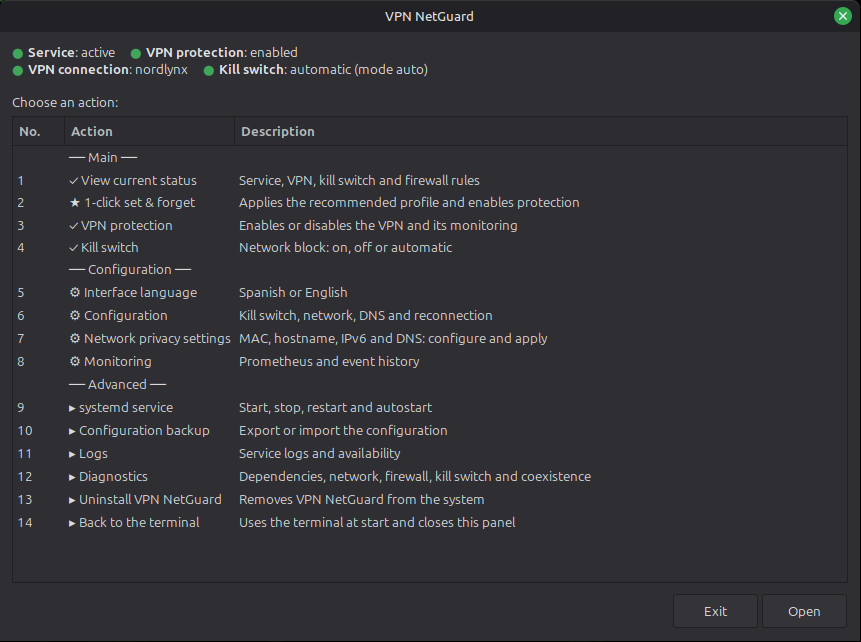
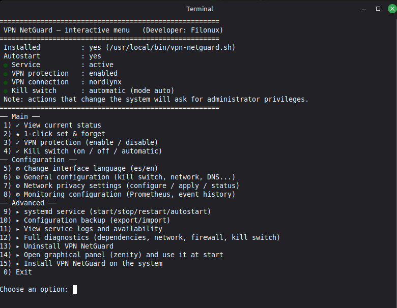
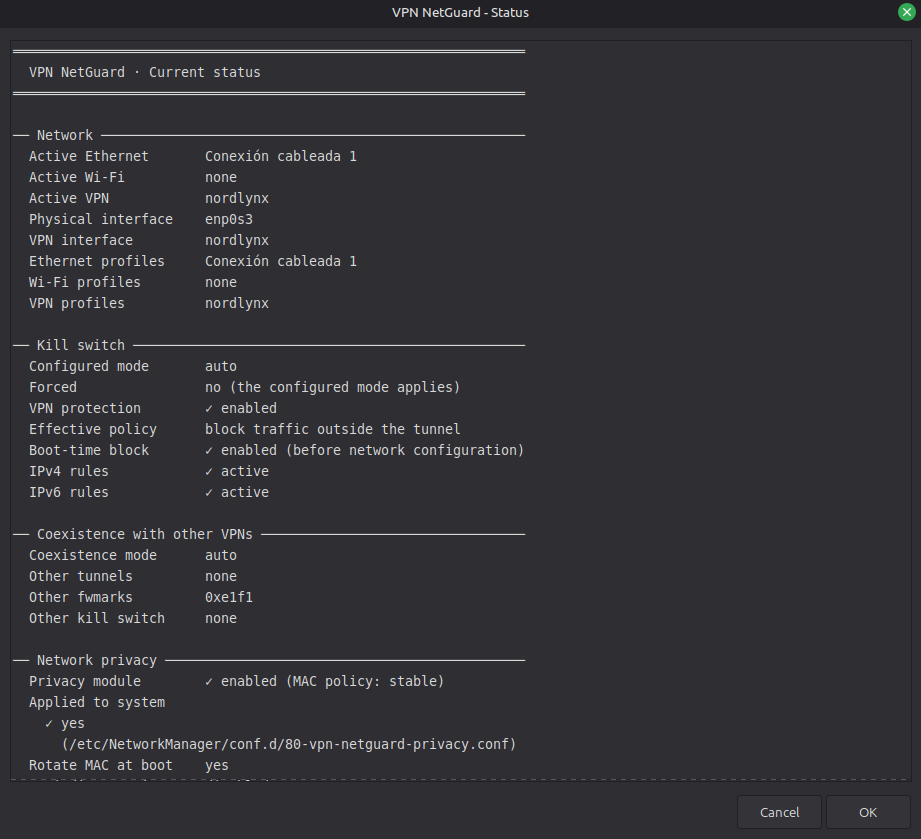
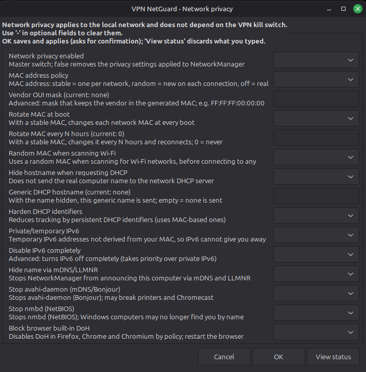
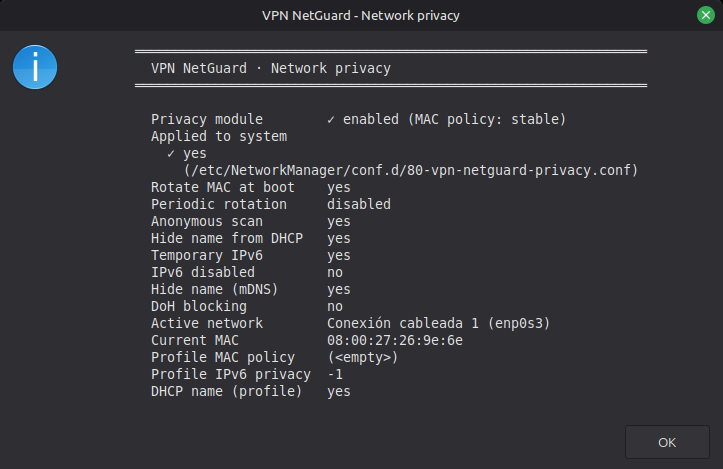

<p align="center">
  
</p>

<h1 align="center">VPN NetGuard</h1>

<p align="center">
  Kill switch, automatic reconnection, and network privacy for your VPN on Linux.<br>
  One single script: graphical panel, terminal menu, or headless systemd service — your choice.
</p>

<p align="center">
  
  
  
  <a href="LICENSE.txt"></a>
  
</p>

<p align="center">
  <a href="README.es.md">Español</a> · <b>English</b>
</p>

---

## What's new in 2.6.0

Everything that changes compared with 1.0.0:

- **Kill switch and VPN protection are now two separate entries.** "VPN protection" (entry 3: enable or disable) and "Kill switch" (entry 4: on, off, or automatic). Before, once you turned the kill switch off there was no direct way back to automatic; now there is: `killswitch auto`. [Daily use](#daily-use)
- **The same menu in the terminal and in the panel.** Numbered, with the same numbers in both, in three groups (Main, Configuration, and Advanced), and the status right at the top. You choose which interface `vpn-netguard.sh` and the Applications menu launcher start with. [The menu](#the-menu) · [Start interface](#start-interface)
- **It coexists with other VPN clients' kill switches** (NordVPN, ProtonVPN...). Two kill switches at the same time cut each other's network. Now VPN NetGuard lets other clients' tunnels through and yields the block while another kill switch is active (`COEXIST_MODE`), and `VPN_IGNORE` keeps it from reconnecting or disconnecting other providers' NetworkManager profiles. [Coexisting with other VPN clients](#coexisting-with-other-vpn-clients)
- **Firewall rules that stay out of the way.** The exceptions end in `RETURN`, not `ACCEPT`, so they no longer skip the later rules of `ufw`, Docker, or other kill switches, and the jump to the chain is no longer removed and reinserted on every check: no window without blocking, and no fight for the first position.
- **"1-click set & forget".** A balanced, compatible profile with a single password (it used to ask up to four), a backup of the configuration, and a final summary. It doesn't touch what can break things: printers, Chromecast, and shared folders. [1-click set & forget](#1-click-set--forget)
- **Clearer status and settings.** "View current status" gathers network, kill switch, coexistence, and network privacy in a single screen; every setting comes with a one-line explanation; a rejected save says why; and in the panel the metrics folder is chosen with a folder picker.
- **The service reloads the configuration by itself** when the file changes, within `CHECK_INTERVAL` seconds at most (25 by default): no restart needed. [Configuration](#configuration)
- **Fixes.** NetworkManager profile names with accents (like "Conexión cableada 1") showed a `?` and could not be queried, reconnected, or excluded; a whitespace-only value in the configuration (such as `DNS_SERVERS=" "`) silently left its rules empty; and `doctor` reported critical with no message when only the optional `ip6tables` was missing.
- **More tests.** 242 tests (146 before), 450 mutation tests, ShellCheck, and a lab with real `iptables` in an isolated network namespace.

## A quick look

<p align="center">
  
  
</p>

<p align="center">
  <sub><b>Graphical panel</b> (left) and <b>terminal menu</b> (right): same numbers, same status at the top.</sub>
</p>

<p align="center">
  
  
</p>

<p align="center">
  <sub><b>Current status</b> (left, entry 1): network, kill switch, coexistence and network privacy on one screen.<br>
  <b>Network privacy settings</b> (right, entry 7): a one-line explanation for every option.</sub>
</p>

<p align="center">
  
</p>

<p align="center">
  <sub><b>Network privacy status</b> (entry 7, "View status").</sub>
</p>

---

## Table of Contents

- [What is VPN NetGuard?](#what-is-vpn-netguard)
- [Getting started](#getting-started)
- [The problem it solves](#the-problem-it-solves)
- [What it actually does](#what-it-actually-does)
- [Installation](#installation)
- [The menu](#the-menu)
- [Commands](#commands)
- [Daily use](#daily-use)
- [1-click set & forget](#1-click-set--forget)
- [Configuration](#configuration)
- [Coexisting with other VPN clients](#coexisting-with-other-vpn-clients)
- [Compatibility](#compatibility)
- [Scriptya](#scriptya)
- [About the language](#about-the-language)
- [Contributing](#contributing)
- [Security](#security)
- [License](#license)

## What is VPN NetGuard?

VPN NetGuard is a **privacy tool** for Linux. If you use a VPN so your Internet provider, the Wi-Fi network you're on, or the sites you visit can't see what you're doing or your real location, VPN NetGuard makes sure that protection doesn't quietly fail on you.

Specifically, it protects you from two things:

- **Your VPN failing silently.** If the connection drops, the computer reboots, or the tunnel stops working without warning, your "real" (unprotected) traffic normally starts going out to the Internet without you noticing, exposing your IP and your activity. VPN NetGuard blocks all traffic the moment it detects the VPN isn't working, and won't let anything through again until it's back up — even during the computer's own boot process.
- **Being identified even while the VPN is working fine.** Beyond your traffic, your computer introduces itself to any Wi-Fi network (the one at the bar, the airport, or the office) using things like its MAC address or hostname. That lets networks recognize you and track you from one place to another, even with the VPN active. VPN NetGuard can hide and change that information automatically.

And this doesn't depend on the VPN itself being the problem: if it's your Internet connection that's unstable — flaky Wi-Fi, a router that hiccups — VPN NetGuard handles it just as well. As soon as there's a signal again, it reconnects the VPN right away on its own, so you're protected and back online as fast as possible, with nothing for you to do.

In short: if your VPN is the lock, VPN NetGuard is what keeps checking that the door is actually shut — and it also helps you avoid leaving footprints along the way.

And it doesn't have to be your desktop computer: it works just the same on a headless server you only reach over SSH — a VPS, a NAS, a headless Raspberry Pi... It's the same script either way: it detects on its own where it's running and adapts, without you having to specify anything.

## Getting started

If you just want to try it out, this is all you need:

1. **Download the script:**

   ```bash
   git clone https://github.com/filonux/VPN-NetGuard.git
   cd VPN-NetGuard/script
   ```

2. **Install it.** On a desktop (Linux Mint, for example):

   ```bash
   pkexec bash vpn-netguard.sh install
   ```

   On a headless server, over SSH:

   ```bash
   sudo bash vpn-netguard.sh install
   ```

   A wizard (graphical or text-based, depending on the case) asks you a couple of simple yes/no questions, and that's it — it's installed.

3. **Use it day to day** without ever touching the terminal again: look for "VPN NetGuard" in the Applications menu (or double-click the Desktop icon, if you chose that option during install). A window opens with a numbered list of actions grouped by category; the ones you'll use almost every time are right at the top — "View current status", "VPN protection" (enable or disable), and "Kill switch" — and if it's your first time, "1-click set & forget" gets everything configured and connected in a single step, with a single password. Double-click the option you want, and as soon as it finishes, the same window comes back for the next one, with nothing to memorize. [The menu](#the-menu) lists them all.

   If you'd rather manage it from a terminal (over SSH on a headless server, for example), there's the same menu in text mode, with the same numbering: just run `vpn-netguard.sh` on its own and pick each option with the keyboard — no commands to remember there either. The terminal is the default start interface; if you choose "Open graphical panel (zenity) and use it at start", `vpn-netguard.sh` with no arguments will open the panel from then on ([Start interface](#start-interface)).

Need more detail — unattended install flags, how to uninstall, the full list of commands...? Keep reading: the sections below cover everything else, starting with the reasoning behind each design decision.

## The problem it solves

Most "VPN kill switches" floating around forums are two or three `iptables` rules applied by hand, once. They work as long as nothing changes — but if the VPN drops in the middle of the night, your laptop reboots, or the tunnel goes "zombie" (the interface stays up but the remote server no longer responds), those rules never notice, and your real traffic goes out to the Internet unprotected, without you ever knowing.

VPN NetGuard is a daemon that continuously watches the connection, not a loose rule. The difference shows up exactly where a homemade kill switch fails: the system's own boot process (even before the network exists), a zombie tunnel a simple ping wouldn't catch, or the moments when nobody's watching. Separately, it adds a network privacy module so that, even when the VPN is working perfectly, the router at the bar, the airport, or the office can't recognize you by your MAC address, your IPv6, or your hostname — something no kill switch alone covers. How it pulls each of these off is in the next section.

## What it actually does

VPN NetGuard brings together in a single file what used to be seven (the watcher, the panel, the installer, the configuration, two systemd units, and the desktop launcher). Here's what it does:

### A real kill switch (fail-closed)

- Blocks all outbound traffic that doesn't go through the VPN tunnel, using `iptables` and `ip6tables` rules applied atomically: there's never a moment where the chain is left half-built or empty.
- A second systemd service, independent of the main one, shuts down traffic *before* the network is even configured at boot — the leak window almost no other script covers.
- Explicitly allows only the bare minimum needed to work: DNS (only to the servers you define, not to just anyone), the traffic needed to establish the tunnel itself, your LAN traffic if you enable it, and ping to whatever targets you use to check for real Internet access.
- Three modes, depending on what you need: `auto` (blocking only kicks in when you activate the VPN), `true` (permanent blocking while the service runs), or `false` (just watches and reconnects, without blocking anything). On top of those modes, `killswitch on` and `killswitch off` force the block or remove it, and `killswitch auto` goes back to the configured mode.
- Coexists with other VPN clients' kill switches (NordVPN, ProtonVPN...): by default it lets their tunnels through and yields the block while theirs is active. Details in [Coexisting with other VPN clients](#coexisting-with-other-vpn-clients).

### Monitoring and automatic reconnection

- Reacts instantly to NetworkManager events (`nmcli monitor`), and also runs a backup check every few seconds in case anything slips through.
- Retries the VPN connection with progressive backoff, so it doesn't hammer a server that's been down for a while.
- With WireGuard, it doesn't just trust that the interface stays "up": it measures the age of the last handshake to catch a zombie tunnel that a simple ping wouldn't reveal.
- Relies on systemd's watchdog: if something hangs (an `nmcli` or `iptables` call that never returns), systemd restarts the service on its own, with no need for you to step in.

### Network privacy (independent of the VPN)

- Randomized MAC per network: the same MAC every time you return to a known network, or a different one on every connection, your choice — with the option to make the reported vendor look real instead of "obviously random."
- Also randomizes the MAC used when scanning for Wi-Fi networks, even before you connect to any of them.
- Hides your hostname from the router's DHCP and fixes a little-known leak (the DHCP client identifier, the DUID, and the IAID) that can still give you away even after the MAC changes.
- Private, temporary IPv6 addresses, or the option to disable IPv6 entirely if you'd rather minimize your footprint as much as possible.
- Can silence your hostname broadcast over mDNS/Avahi and NetBIOS, and force Firefox, Chrome, and Chromium to stop resolving DNS on their own (DNS-over-HTTPS), so they respect your DNS settings and the kill switch itself.

### Alerts, history, and monitoring

- Desktop notifications when the state actually changes, not on every periodic check.
- An alert "hook" (`ALERT_HOOK`) for headless servers: plug in a webhook, an email, or whatever you need there.
- Event history in CSV, meant to be imported into a spreadsheet or used to chart uptime over time.
- Metrics for Prometheus (node_exporter's textfile collector format) and a `check` subcommand with an exit code, ready for cron, Nagios, or Zabbix.

### Three ways to manage it

- Graphical panel (zenity) for everyday desktop use.
- Interactive terminal menu, which needs neither zenity nor the program already installed — designed for use over SSH.
- Direct subcommands for automation, debugging, or integration into your own scripts.

## Installation

The installer only detects whether you have a graphical session and picks the right wizard — nothing to specify. It uses the same commands from [Getting started](#getting-started) (`pkexec bash vpn-netguard.sh install` on desktop, `sudo bash vpn-netguard.sh install` over SSH); here's what each wizard asks:

- **With a graphical session (zenity):** autostart at boot, starting the service right away, an entry in the Applications menu — and, if so, a Desktop icon too — and whether to apply network privacy now.
- **Over SSH, text mode:** the same questions except the Desktop icon one, which doesn't apply without a graphical session.

The network privacy question always comes up; if the installer detects you're connected over SSH, it shows a stronger warning first, since changing your MAC could cut your own connection if your provider filters by it.

**Unattended install (Ansible, cloud-init, Dockerfile...):** `install` also accepts flags — or the `VPN_NETGUARD_INSTALL_*` environment variables — that skip the interactive yes/no questions:

```bash
sudo bash vpn-netguard.sh install --yes
sudo bash vpn-netguard.sh install --autostart --start-now --no-privacy
```

`--yes`/`-y` sets autostart, immediate start, and the Applications menu entry to "yes" and network privacy to "no" (unless a specific flag says otherwise) — the same privacy caution described above for remote servers. Individual flags: `--[no-]autostart`, `--[no-]start-now`, `--[no-]privacy`, `--[no-]menu-entry`. With none of these, install stays interactive as always, and it has no effect on the graphical (zenity) installer.

VPN NetGuard needs NetworkManager (`nmcli`) in either case. If your server uses netplan with the plain `networkd` renderer, install it first:

```bash
sudo apt install network-manager
sudo systemctl enable --now NetworkManager
```

If any other dependency is missing (`iptables`, `ping`...), the script itself tells you exactly what's missing and which `apt` package installs it — no guessing required.

Once installed, forget about `pkexec`/`sudo` for everyday use: look for "VPN NetGuard" in the Applications menu, or just run `vpn-netguard.sh` with no arguments (it opens the terminal menu or, if you chose it, the panel). Every action that needs privileges asks for them separately, so you never need to deliberately open a terminal as root.

**Uninstalling:**

```bash
sudo bash vpn-netguard.sh uninstall
```

or option 13 in the interactive menu. `/etc/vpn-netguard/vpn-netguard.conf` is kept in case you reinstall later; remove it by hand (`sudo rm -rf /etc/vpn-netguard /var/lib/vpn-netguard`) if you no longer need it.

**Optional alternative way to launch it:** if you organize your scripts with [Scriptya](#scriptya), by the same author, you can add `vpn-netguard.sh` to its menu and stop worrying about remembering the path either — explained further down.

## The menu

The terminal menu and the graphical panel share the same numbering: each entry has the same number in both. The panel goes up to 14; only "Install" (15) exists in the terminal alone. Entry 14 is the same entry in both, with the opposite action in each ([Start interface](#start-interface)).

| No. | Entry | What it does |
|---|---|---|
| 1 | View current status | Service, VPN, kill switch (with its forced state), coexistence with other VPNs, and firewall rules |
| 2 | 1-click set & forget | Applies the recommended profile and enables protection. Details in [1-click set & forget](#1-click-set--forget) |
| 3 | VPN protection | Enables or disables VPN protection: same as `activate` and `deactivate` |
| 4 | Kill switch | Turns the network block on, off, or back to automatic, or shows its status: same as `killswitch on`, `off`, `auto`, and `status` |
| 5 | Interface language | Spanish or English. It also updates the already-installed systemd units and launcher |
| 6 | Configuration | Kill switch, coexistence, networks and VPN profiles, DNS, and reconnection |
| 7 | Network privacy settings | MAC, hostname, IPv6, and DNS (`apply-privacy`, `privacy-status`). Panel: the settings form, where OK saves and applies and "View status" shows the status. Terminal: configure, apply now, and view the status |
| 8 | Monitoring | Prometheus metrics and event history |
| 9 | systemd service | Start, stop, restart, and autostart |
| 10 | Configuration backup | Export or import the configuration (`export-config`, `import-config`) |
| 11 | Logs | Service logs and availability |
| 12 | Diagnostics | Dependencies, network, firewall, kill switch, and coexistence (`doctor`) |
| 13 | Uninstall VPN NetGuard | Removes VPN NetGuard from the system (`uninstall`) |
| 14 | Open graphical panel (zenity) and use it at start | In the terminal it opens the panel and makes it the start interface. In the panel it is "Back to the terminal": it makes the terminal the start interface and closes the panel |
| 15 | Install VPN NetGuard on the system | Terminal only (`install`) |

### Panel screens

Screenshots of these screens are at the top of this README, in [A quick look](#a-quick-look).

**Current status** (entry 1): network, kill switch, coexistence with other VPNs, and network privacy in a single screen.

**Network privacy settings** (entry 7): each option carries a one-line explanation. OK saves and applies (it asks for confirmation first); "View status" discards what you typed and shows the status.

### Start interface

`vpn-netguard.sh` with no arguments opens the terminal menu, unless you choose to use the panel:

- **In the terminal**, entry 14 opens the panel and makes it the start interface: from then on `vpn-netguard.sh` starts in the panel.
- **In the panel**, the same entry is "Back to the terminal": it makes the terminal the start interface and closes the panel. If you started with `vpn-netguard.sh` and no arguments from a terminal, the text menu carries on in it.
- The preference is per user: it is stored in `~/.config/vpn-netguard/start-ui` (or under `XDG_CONFIG_HOME`) and asks for no password.
- `menu` and `panel` are explicit and never consult it. The Applications menu launcher (and the Desktop icon) runs `launch`, which does: it opens the panel unless you chose the terminal, in which case the text menu opens in a terminal window of its own (the first emulator found, such as `gnome-terminal` or `xterm`). With none installed it says so and opens the panel if it can.
- With the panel chosen but unable to open (no zenity, no graphical session, or the program not installed), the reason goes to standard error and the text menu opens. From the launcher the reason is not shown: you only see the terminal window with the text menu.

## Commands

| Command | What it does |
|---|---|
| *(no arguments)* | Opens the start interface: the terminal menu or, if you chose it, the panel ([Start interface](#start-interface)) |
| `menu` | Always opens the interactive terminal menu, ignoring the start interface |
| `install` | Installs VPN NetGuard on the system |
| `uninstall` | Uninstalls VPN NetGuard from the system |
| `panel` | Opens the graphical control panel (zenity), ignoring the start interface |
| `launch` | What the Applications menu launcher runs: the start interface (if it is the terminal, in a terminal window of its own) |
| `status` | Shows the current status: interfaces, VPN, kill switch (and whether it is forced), coexistence with other VPNs, DNS, privacy... |
| `check` | Health check with an exit code (`0` OK, `1` warning, `2` critical), designed for cron/Nagios/Zabbix |
| `doctor` | Combined diagnostics: dependencies, NetworkManager, firewall, kill switch, and coexistence with other VPNs |
| `one-click` | The recommended profile in one step and with a single password: config backup, network privacy, VPN protection, and service restart. It asks nothing. Exits with `0` (applied), `1` (nothing changed), or `2` (profile saved, but a step failed) |
| `activate` | Enables VPN protection: marks that you want the VPN, connects, and watches it. Removes a kill switch forced OFF, but respects one forced ON |
| `deactivate` | Disables VPN protection: disconnects the VPN (except `VPN_IGNORE` profiles) and forces the kill switch OFF |
| `killswitch on\|off\|auto\|status` | Single kill switch control: `on` always blocks, `off` never blocks, `auto` clears the forced state so `KILLSWITCH_MODE` rules again, `status` shows the state |
| `enable-killswitch` / `disable-killswitch` | Aliases of `killswitch on` / `killswitch off` |
| `apply-privacy` | (Re)applies the network privacy module (MAC, IPv6, hostname...) |
| `privacy-status` | Shows the current status of network privacy |
| `export-config [path]` | Copies `vpn-netguard.conf` to `path` (by default `./vpn-netguard-YYYYMMDD.conf` in the current folder) |
| `import-config <path>` | Replaces `vpn-netguard.conf` with a previously exported one, after checking its syntax and content; it first saves a backup of the current one |
| `sync-localized` | Rewrites the already-installed systemd units/`.desktop` launcher in the current language |
| `rotate-mac` | Immediately regenerates the "stable" MAC (used by the optional timer) |
| `start` | Starts the watcher in the foreground (used by systemd, no need to run by hand) |
| `boot-killswitch` | Early blocking before the network exists (used by systemd) |
| `version` / `--version` / `-v` | Shows the installed version |
| `-h` / `--help` | Shows this same help text |

Almost all of them require root privileges: use `sudo`, `pkexec`, or leave it to the systemd service, which already invokes itself correctly. These can run without root: the interactive menu and the graphical panel, which ask for privileges action by action as you need them; `version` and `--help`, which don't need them at all; `export-config`, which only reads the config file; and `doctor`, which without root skips the firewall, kill switch, and coexistence checks and counts them as a warning in its exit code.

## Daily use

Everyday use doesn't need a terminal, but if you do use one:

```bash
vpn-netguard.sh status               # what's connected, whether the kill switch blocks (and whether it is forced), real DNS...
vpn-netguard.sh activate             # enables VPN protection: connects and watches
vpn-netguard.sh deactivate           # disables it: disconnects and forces the kill switch OFF
vpn-netguard.sh killswitch status    # just the kill switch: forced state and effective policy
vpn-netguard.sh panel                # the same graphical panel, without hunting for it in the Applications menu
```

VPN protection and the kill switch are two different things, and that difference is the first thing almost everyone asks:

| What you control | Commands | What it changes | When to use it |
|---|---|---|---|
| **VPN protection** | `activate` / `deactivate` | Whether you **want** the VPN active: connects or disconnects it, watches it, and reconnects it | Normal, everyday use |
| **Kill switch** | `killswitch on\|off\|auto` | Only the network block, **without** connecting or disconnecting the VPN | One-off debugging, or testing the block without touching the connection |

The kill switch has three commands:

| Command | Effect |
|---|---|
| `killswitch on` | Always blocks, also after a reboot |
| `killswitch off` | Never blocks |
| `killswitch auto` | Clears the forced state: `KILLSWITCH_MODE` rules again (default `auto`: the block applies while you want the VPN active). Takes effect immediately, without restarting the service |

And this is how the two relate:

- `activate` only removes a forced OFF. If you forced ON, it respects that: enabling protection never weakens the kill switch.
- `deactivate` forces OFF so you are not left without a network, and disconnects the VPN, except `VPN_IGNORE` profiles. To go back to automatic behavior, run `activate` or `killswitch auto`.

For unattended monitoring, for example on a server:

```bash
vpn-netguard.sh check
```

Returns a one-line summary and an exit code (`0` = OK, `1` = warning, `2` = critical); if you set `PROMETHEUS_TEXTFILE_DIR`, it also drops metrics ready for node_exporter in that same call.

And to see what the service is doing in real time:

```bash
journalctl -u vpn-netguard.service -f
```

## 1-click set & forget

Applies the recommended profile and enables VPN protection in a single step, with a single password. It appears in the menu and the panel as "1-click set & forget", and in the terminal as `one-click`.

The menu and the panel ask for confirmation first — with a stronger warning if you are on SSH, because changing the MAC could cut your connection — and call `one-click` just once. The subcommand itself asks nothing.

What it does, in order:

1. Checks that the configuration exists and that NetGuard accepts it. If not, it stops without changing anything.
2. Shows read-only warnings, if any: another VPN client's kill switch or tunnel, or the service installed without autostart. They don't change the outcome.
3. Saves a backup, `vpn-netguard.conf.bak-XXXXXXXX`, next to the configuration (the same one `import-config` creates).
4. Writes the profile from the table below. If the write fails, it restores the configuration from that backup.
5. Applies network privacy, enables VPN protection, and restarts the service (if installed). Each step shows as ✓ or ✗, with its log only if it fails, and all three run even if one fails.

Exit code: `0` profile applied; `1` nothing was changed (no configuration, configuration rejected, backup impossible, or profile not saved); `2` profile saved, but a later step failed (for example, VPN protection when there is no VPN profile in NetworkManager).

The profile is "balanced and compatible": it keeps on what protects without breaking anything and leaves alone what could. It has 16 keys:

| Key | 1-click | Default |
|---|---|---|
| `KILLSWITCH_MODE` | `auto` | `auto` |
| `COEXIST_MODE` | `auto` | `auto` |
| `KILLSWITCH_BOOT_RACE_AUTO_DISABLE` | `true` | `false` |
| `ALLOW_LAN` | `true` | `true` |
| `DESKTOP_NOTIFICATIONS` | `true` | `true` |
| `ANONYMIZE_NETWORK` | `true` | `true` |
| `MAC_MODE` | `stable` | `stable` |
| `ROTATE_MAC_PER_BOOT` | `true` | `false` |
| `RANDOMIZE_SCAN_MAC` | `true` | `true` |
| `SPOOF_HOSTNAME` | `true` | `true` |
| `HARDEN_DHCP_IDENTIFIERS` | `true` | `true` |
| `IPV6_PRIVACY` | `true` | `true` |
| `DISABLE_MDNS_ANNOUNCE` | `true` | `true` |
| `DISABLE_AVAHI_SERVICE` | `false` | `false` |
| `DISABLE_NETBIOS_SERVICE` | `false` | `false` |
| `HARDEN_BROWSER_DOH` | `false` | `false` |

- `KILLSWITCH_BOOT_RACE_AUTO_DISABLE=true` is the safety net: if the block gets stuck at boot because a VPN client with its own kill switch is contesting it, and after several checks there is still no active VPN, NetGuard lets go and warns you instead of leaving you offline.
- `MAC_MODE=stable`, not `random`: a new MAC on every connection breaks captive portals and DHCP reservations. With `ROTATE_MAC_PER_BOOT=true` the MAC changes on every boot, but not mid-session.
- The three settings that can break things stay `false`: `DISABLE_AVAHI_SERVICE` (printers and Chromecast), `DISABLE_NETBIOS_SERVICE` (shared folders with Windows), and `HARDEN_BROWSER_DOH` (Firefox, Chrome, and Chromium DoH policies). If you had them enabled, `apply-privacy` restores what NetGuard had restricted. The stricter options remain available in "Network privacy settings".

## Configuration

All the configuration lives in a single file, commented line by line:

```
/etc/vpn-netguard/vpn-netguard.conf
```

It's generated with sensible defaults on install, and isn't overwritten on later installs. Some of the most relevant keys:

```bash
LANGUAGE="es"                    # es | en — language for menus, panel, and messages (detected from the system at install)
KILLSWITCH_MODE="auto"           # auto | true | false
COEXIST_MODE="auto"              # auto | strict — coexistence with other VPN clients' kill switches
VPN_IGNORE=""                    # NetworkManager profiles from another provider that NetGuard does not manage
DNS_SERVERS="1.1.1.1 9.9.9.9"    # which DNS servers are allowed out while the kill switch is blocking
MAC_MODE="stable"                # stable | random | off
IPV6_PRIVACY="true"
PROMETHEUS_TEXTFILE_DIR=""       # empty = disabled
ALERT_HOOK=""                    # your script or webhook, for headless servers
```

You can edit it by hand, from the interactive menu (options 6, 7, and 8), or the graphical panel ("Configuration", "Network privacy settings", and "Monitoring"). The service detects the change and applies it by itself, within `CHECK_INTERVAL` seconds at most (25 by default): no restart needed.

There is one exception: network privacy (MAC, hostname, IPv6, DNS-over-HTTPS...) is only applied when you run `apply-privacy`, because the service does not run it on its own. In the terminal menu, that is "Network privacy settings" > "Apply now"; in the graphical panel, OK in that form applies it.

## Coexisting with other VPN clients

Some VPN clients, such as NordVPN or ProtonVPN, ship their own kill switch. Two kill switches that end in a `DROP` do not cancel each other: they stack. Each one blocks what it does not know about the other (the tunnel and its initial connection), and the network goes down. `COEXIST_MODE` decides how VPN NetGuard avoids that:

| `COEXIST_MODE` | What it does |
|---|---|
| `auto` (default) | Lets other clients' tunnels and marks through and yields the block while another kill switch is active |
| `strict` | Always blocks, with no exceptions for other clients. `status` and `doctor` still warn if they detect one |

In `auto`:

- **Lets other clients through:** active tunnels that NetworkManager does not manage (`tunN`, `tapN`, `wgN`, `pppN`, `protonN`, `nordlynx`, and `nordtun`) and NordVPN's `0xe1f1` mark, if there is a trace of that client. These exceptions, like all of VPN NetGuard's, end in `RETURN`, not `ACCEPT`: whatever they allow keeps going through the rules that follow (`ufw`, Docker, other kill switches) instead of skipping them. Anything that matches no exception is cut by the final `DROP`.
- **Yields the block** only when all of this holds at once: nothing is forced (neither `killswitch on` nor `off`), `KILLSWITCH_MODE="auto"`, a VPN profile is known, VPN protection is on, and another kill switch is active. A desktop notification appears when it starts yielding; each change (start, switching client, stop yielding) is logged. `status`, the menu, and the panel show it, and `check` exits `0` as long as there is Internet.
- **Never yields** with `killswitch on` or `KILLSWITCH_MODE="true"`: there it always blocks, though it still lets other clients' tunnels and marks through.

What it recognizes, always read-only:

| Client | Detection |
|---|---|
| NordVPN | `nordlynx` or `nordtun` interface, the `nordvpn` command, or rules with the `nordvpn` comment. Its kill switch is one of those rules with `DROP` or `REJECT` in `OUTPUT`; reading the firewall requires root |
| ProtonVPN | Its kill switch uses no firewall rules: it is an active NetworkManager connection (`pvpn-killswitch` or `pvpn-ipv6leak-protection`) or its interface (`pvpnksintrf0`, `ipv6leakintrf0`) |

If detection does not match on your machine, open an issue.

### Seeing what it detects

`status` and `doctor` include the "Coexistence with other VPNs" section: the mode, and the tunnels, marks, and other kill switches detected, plus a recommendation when one is needed:

- With `strict`, blocking active, and another client detected: `COEXIST_MODE="auto"`.
- With the block forced by `killswitch on` while another kill switch is active: `killswitch auto`. With `KILLSWITCH_MODE="true"`: `KILLSWITCH_MODE="auto"`.
- With ProtonVPN's kill switch active and no tunnel, which may be cutting the network: `nmcli connection down pvpn-killswitch`.

A recommendation raises the `doctor` result to warning (`1`) and never lowers a critical. Without root, `doctor` skips the section. `one-click` runs a similar check before it starts.

### Other providers' profiles in NetworkManager

If another client creates its own VPN or WireGuard profiles in NetworkManager, VPN NetGuard would treat them as its own: it would reconnect or disconnect them. List those profiles in `VPN_IGNORE`, as shell-style patterns (`*`, `?`, `[ ]`) separated by spaces or commas, matched against the full profile name and case-sensitive:

```bash
VPN_IGNORE="ProtonVPN* My?work"
```

A profile in `VPN_IGNORE`:

- Is neither reconnected nor disconnected: `deactivate` leaves it connected and logs it.
- When connected, counts as the active VPN: its tunnel is let through and there is no "VPN down".
- Can connect while VPN NetGuard is blocking: its server is added to the block's exceptions.
- Shows up in `status` as "Ignored VPN profiles".

Keep in mind:

- A space inside a name is written `?` (`My?work` matches "My work").
- `VPN_CONNECTION` wins: the profile you set there is never ignored.
- If you ignore every profile, VPN NetGuard has no VPN to manage and `activate` says so.
- The configuration accepts lines of up to 1024 characters (already escaped). If `VPN_IGNORE` exceeds that, the whole file is rejected and everything goes back to the defaults, with a warning in the log.

### At boot

The boot block acts before NetworkManager exists, so it sees less. In `auto` it lets through other clients' tunnels that are already active and NordVPN's mark. It does not see NetworkManager profiles (`VPN_IGNORE`, ProtonVPN) or ProtonVPN's kill switch, and it never yields the block: the service does that a few seconds later, once NetworkManager is running. Until then those clients cannot connect.

If the block gets stuck because another client is contesting it, `KILLSWITCH_BOOT_RACE_AUTO_DISABLE="true"` (set by 1-click) releases it after 40 s without an active VPN and notifies you. The kill switch stays forced to `off`: go back to automatic with `killswitch auto`.

## Compatibility

- **Primary target:** Linux Mint 22.3 (Cinnamon), with a graphical panel and a shortcut in the Applications menu.
- **Also as a headless service:** any Debian/Ubuntu server with NetworkManager, no graphical environment or zenity needed — installs and works the same way over SSH, swapping `pkexec` for `sudo`.
- **Requirements:** Bash 4+, NetworkManager (`nmcli`), `iptables`, `systemd`. Everything else (coreutils, `ping`, `flock`...) is usually already part of the base system.

Optional — none of this is required, but it improves the experience:

| Package | What for |
|---|---|
| `ip6tables` | Kill switch on IPv6 too (highly recommended) |
| `zenity` | Graphical panel and installer with windows |
| `wireguard-tools` (`wg`) | Zombie tunnel detection on WireGuard connections |
| `libnotify-bin` (`notify-send`) | Desktop notifications |
| `policykit-1` (`pkexec`) | Elevating privileges without a terminal, from the panel/menu |

Should work unmodified on any Ubuntu/Debian derivative with NetworkManager, though for now it's only been verified on Linux Mint 22.3 Cinnamon and on a headless Ubuntu/Debian server. It uses its own `iptables` chain, independent of `ufw`'s, and its exceptions end in `RETURN`, not `ACCEPT`: whatever it allows keeps going through the later `ufw` or Docker rules instead of skipping them. For other VPN clients, see [Coexisting with other VPN clients](#coexisting-with-other-vpn-clients).

## Scriptya

VPN NetGuard doesn't need anything else to work. If you keep several of your own scripts around, [Scriptya](https://github.com/filonux/Scriptya) — by the same author — is a menu that organizes them and can turn any of them into a standalone app with its own icon.

Dropping `vpn-netguard.sh` into your Scriptya scripts folder gets you a shortcut to launch it without having to remember the path. Keep in mind, though: Scriptya's "install" only creates that shortcut. Actually installing VPN NetGuard — the systemd services, the kill switch, the privacy module — is still done once with `vpn-netguard.sh install`, as described above.

## About the language

The interface is bilingual: the interactive menu, the graphical panel, the installation wizard, and the status messages are all available in Spanish and English. On install, VPN NetGuard detects the system language (English if the locale is `en_*`, Spanish in any other case) and saves it in `LANGUAGE`, in `/etc/vpn-netguard/vpn-netguard.conf`.

To change it, use the interface itself (option 5 in the menu, "Interface language" in the panel): it saves `LANGUAGE` and rewrites the already-installed systemd units and `.desktop` launcher (`sync-localized`). If you edit `LANGUAGE` by hand, the service detects it by itself, without a restart, but those files don't change until you run `sudo vpn-netguard.sh sync-localized`.

You can also force it for a single run, without touching the configuration, with the `VPN_NETGUARD_LANGUAGE` environment variable:

```bash
VPN_NETGUARD_LANGUAGE=en vpn-netguard.sh status
```

This README is also available in both languages — the link is right at the top, just below the badges.

**Mini roadmap**, depending on real interest:

- [x] Bilingual interface (Spanish/English): menu, panel, and installation wizard
- [x] Bilingual README (Spanish/English)
- [ ] A `.deb` package or dedicated `apt` repository, to install with `apt install` instead of cloning the repo

If you'd be interested, open an issue — that's the signal I need to prioritize it.

## Contributing

Issues and pull requests are welcome. Ready-made templates are available in `.github/` for reporting a bug or proposing an improvement, along with a full guide in [CONTRIBUTING.md](.github/CONTRIBUTING.md).

## Security

VPN NetGuard runs as root and modifies firewall rules. If you find a security issue, please report it following the process in [SECURITY.md](.github/SECURITY.md) instead of opening a public issue.

## License

Free software under the GNU General Public License version 3 (GPLv3). See the [LICENSE](LICENSE.txt) file for the full text.

---

<p align="center">Made by <strong><a href="https://github.com/filonux">Filonux</a></strong>.</p>
